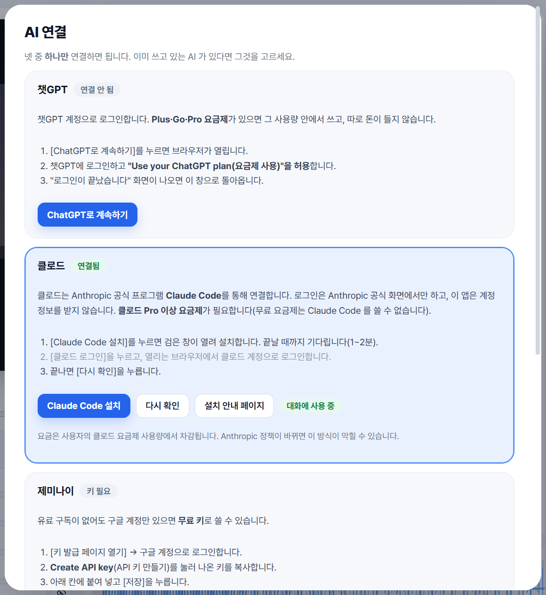
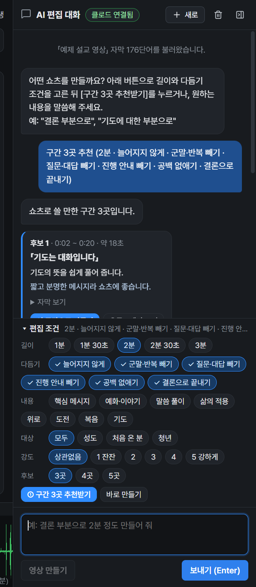

<div align="center">

# 설교쇼츠편집기 · SermonShorts

**설교 영상 주소를 넣고, AI 와 대화하며 쇼츠를 만듭니다.**

"결론 위주로 2분 정도", "회중에게 묻는 말은 빼 줘"처럼 말로 부탁하면<br>
교회 이름·설교자·성경 구절이 들어간 세로 영상(1080×1920)과 자막 파일이 나옵니다.

[**⬇ 내려받기 (Windows)**](https://github.com/hahadark/sermon-shorts/releases/latest) · [사용 설명서](docs/USER_GUIDE.md) · [설치 안내](docs/INSTALL.md)

</div>

## 이 링크를 받으셨나요? 이렇게 하세요

처음 한 번만 1~3을 하고, 그다음부터는 **4번만** 하면 됩니다.

**1. 프로그램 설치**
- [내려받기 페이지](https://github.com/hahadark/sermon-shorts/releases/latest)의 **Assets** 아래에서 `SermonShorts-Setup-버전-x64.exe`(Windows)를 눌러 받고 실행합니다.
- 파란 경고창(PC 보호)이 나오면 **추가 정보 → 실행**을 누릅니다. (코드 서명이 없는 무료 프로그램이라 나오는 경고입니다)
- 설치 끝에 *"자막 엔진도 설치할까요?"*가 나오면 **아니요**를 눌러도 됩니다.
- 한 번 설치하면 그다음부터는 프로그램이 새 버전을 알아서 받아 설치합니다.
- Mac 판은 당분간 새로 만들지 않습니다. (예전 Mac 판: [Mac 설치 안내](docs/INSTALL.md#mac-베타))

**2. AI 연결** — 프로그램을 처음 열면 [AI 연결] 창이 뜹니다. 넷 중 **하나만** 연결하세요.

| 쓰고 있는 AI | 하는 방법 | 비용 |
|---|---|---|
| **챗GPT** (Plus·Go·Pro) | [ChatGPT로 계속하기] → 브라우저에서 로그인 → "요금제 사용" 허용 | 내 챗GPT 요금제 안에서 |
| **클로드** (Pro 이상) | [Claude Code 설치] → [클로드 로그인] → [다시 확인] | 내 클로드 요금제 안에서 |
| **제미나이** (구독 없어도 됨) | [키 발급 페이지 열기] → 구글 로그인 → Create API key → 복사해 붙여넣기 | 무료 사용량 안에서 무료 |
| **오픈라우터** (구독 없어도 됨) | [키 발급 페이지 열기] → 가입·로그인 → Create API Key → 복사해 붙여넣기 | 무료 모델만 써서 무료 (하루 횟수 제한) |



**3. 우리 교회 정보** — 위쪽 **⚙ 설정**에서 교회 이름·로고·설교자 이름을 넣습니다.

**4. 매주 만들기**
1. 오른쪽 **AI 편집 대화**에 유튜브 설교 영상 주소를 넣고 [불러오기] (영상은 공개 또는 일부공개)
2. "결론 위주로 2분 정도 만들어 줘"처럼 부탁합니다. 1~2분 뒤 편집이 왼쪽 화면에 들어옵니다.
3. [재생]으로 확인하고, "더 짧게", "질문하는 말 빼 줘", "말 사이를 더 빠르게"처럼 계속 고쳐 달라고 합니다.
4. 마음에 들면 [영상 만들기] → MP4 와 자막(SRT)이 저장됩니다. 유튜브에는 일부공개로 올려 확인한 뒤 공개하세요.



> 자동 자막은 틀린 글자가 있을 수 있습니다. 가운데 자막 칸의 **출력 자막**을 고치면 영상에 나가는 글자만 바뀝니다.
> 우리 교회가 권리를 가진 설교 영상만 쓰세요.


## 이런 분께

- 주일 설교 영상을 **유튜브 쇼츠·릴스**로 나누어 올리고 싶은 교회 미디어 담당자
- 영상 편집 프로그램은 어렵지만 **문서 편집은 할 수 있는** 사역자·봉사자
- 자막 오타를 하나하나 타이밍 맞춰 고치느라 시간이 많이 드는 분

## 무엇이 다른가요

| | 일반 영상 편집기 | 설교쇼츠편집기 |
|---|---|---|
| 자르기 | 타임라인에서 구간을 찾아 자름 | **자막에서 문장을 지우면 영상도 잘림** |
| 자막 | 직접 타이핑하고 시간 맞춤 | **음성 인식 자막이 자동으로 붙고**, 틀린 글자만 고침 |
| 디자인 | 매번 제목·로고 배치 | **교회 테마 한 번 저장** 후 계속 사용 |
| 결과 | 영상만 | **MP4 + 수정된 SRT** 함께 |

## 주요 기능

### 원문과 출력 자막을 따로
음성 인식 결과(STT 원문)는 그대로 두고, 실제로 영상에 나갈 **출력 자막**만 고칩니다. 오타를 고쳐도 영상 시간은 바뀌지 않습니다.


### 여러 구간을 체크해서 한 번에 삭제
필요 없는 부분의 체크박스를 고르고 **선택 구간 삭제**. 잘못 지웠다면 `Ctrl+Z` 한 번으로 되돌립니다.


### 14자 자막, Backspace로 행 합치기
한 줄 최대 글자 수(기본 14자)에 맞춰 자막을 나누고, 출력 자막 맨 앞에서 `Backspace`를 누르면 위 줄과 합칩니다.


### 파형을 보며 1ms 단위 정밀 트림
컷 경계가 어색하면 파형에서 앞뒤 손잡이를 끌거나 프레임·10ms·1ms 단위로 옮기고, 이음새를 반복해서 들어 봅니다.


### 우리 교회 테마
교회 이름·로고·설교자 목록을 저장하고, 제목·성경 구절·영상·자막 위치와 글꼴·색을 테마로 만들어 둡니다. 기본 테마 6종이 들어 있습니다.


### 유튜브 설교에서 바로
생중계·설교 영상 주소를 넣으면 앱 안에서 미리 보고, **필요한 구간만** 고화질로 받아옵니다.


### AI 와 대화로 편집
챗GPT 로그인, 클로드(Claude Code), 제미나이 키 중 하나를 연결하면 유튜브 자동 자막을 보고 구간을 골라 편집기에 바로 넣어 줍니다. 필요한 부분만 영상으로 받고, 흘어진 구간은 이어 붙입니다. 음성 인식 엔진은 필요 없습니다.

### (선택) AI 쇼츠 추천
본인의 Gemini API 키를 넣으면 설교 전체를 분석해 쇼츠로 만들 만한 구간 후보를 추천합니다. 기본 편집과 음성 인식은 키 없이, 인터넷 비용 없이 PC에서 동작합니다.


## 3분 만에 시작하기

1. **설치** — [Releases](https://github.com/hahadark/sermon-shorts/releases)에서 `SermonShorts-Setup-x.y.z-x64.exe`를 받아 실행합니다. (Mac은 [Mac 설치 안내](docs/INSTALL.md#mac-베타) 참고)
2. **(선택) 자막 엔진** — 유튜브 주소로 AI 와 대화해 만들 때는 필요 없습니다. 컴퓨터에 있는 영상 파일에 자막을 새로 만들 때만, 설치 마지막 질문에서 **예**를 누릅니다(약 5~6GB, 10~30분).
   건너뛰었다면 앱 상단 **점검** 창의 **엔진 설치** 버튼으로 언제든 설치할 수 있습니다.
3. **편집** — **영상 열기** → **자막 만들기** → 필요 없는 구간 삭제 → 출력 자막 오타 수정 → **내보내기**(`Ctrl+E`).


자세한 사용법은 [사용 설명서](docs/USER_GUIDE.md)(캡처 포함)를 참고하세요.

## 자주 쓰는 키

| 키 | 동작 |
|---|---|
| `Space` | 재생 / 정지 |
| `Backspace` / `Delete` (원문 줄) | 커서 앞/뒤 단어와 그 영상 구간 삭제 |
| `R` | 지운 부분 되살리기 |
| `T` | 가까운 컷 정밀 트림 열기 |
| `Ctrl+Z` / `Ctrl+Shift+Z` | 실행 취소 / 다시 실행 |
| `Ctrl+S` / `Ctrl+O` / `Ctrl+E` | 저장 / 프로젝트 열기 / 내보내기 |
| `F1` | 전체 단축키 도움말 |

## 필요 환경

- **Windows 10/11 64비트**, 여유 공간 10GB 이상 권장
- **macOS (베타)** — Apple 칩(M1 이상) 권장, Intel Mac도 빌드 제공
- NVIDIA GPU가 있으면 음성 인식·출력이 빠릅니다. 없거나 Mac이면 CPU로 동작합니다(느림).
- 설치 파일에 포함: 앱, ffmpeg·ffprobe, yt-dlp, 공개 라이선스 글꼴
- 별도 설치(설치 중 자동): Python 3.12, PyTorch, faster-whisper, Whisper 모델

## 알아 두세요

- **베타 버전**입니다. 코드 서명이 없어 Windows SmartScreen 경고가 나오면 *추가 정보 → 실행*을 누르세요. Mac은 [처음 여는 방법](docs/INSTALL.md#mac-베타)을 참고하세요. 릴리스 페이지의 SHA256으로 파일을 확인할 수 있습니다.
- 프로젝트 파일(`.sshorts`)에는 **원본 영상이 들어가지 않습니다.** 원본을 함께 보관하세요.
- 본인 교회의 영상이나 **사용 허가를 받은 설교**만 사용하세요.
- AI 대화 편집은 연결한 AI 의 요금제·무료 사용량을 씁니다. 클로드는 공식 Claude Code 를 통해 연결하며, Anthropic 정책이 바뀌면 이 방식이 막힐 수 있습니다. 이 앱은 챗GPT·클로드 비밀번호를 받지 않습니다.

## 개발자용

```powershell
npm ci
npm start          # 소스 실행
npm test           # 오프라인 테스트
npm run build:win  # bin/ffmpeg.exe, ffprobe.exe, yt-dlp.exe 준비 후 dist/ 에 설치 파일·ZIP 생성
npm run build:mac  # Mac용 ZIP (arm64·intel), ffmpeg·yt-dlp 자동 다운로드
```

릴리스: `package.json`의 버전을 올리고 같은 이름의 태그(예: `v0.2.1`)를 푸시하면 GitHub Actions가 Windows에서 빌드해(Mac 빌드는 쉬는 중) [Releases](https://github.com/hahadark/sermon-shorts/releases)에 자동으로 올립니다.

[설계](docs/ARCHITECTURE.md) · [편집 규칙](docs/EDITING.md) · [회귀 검증](docs/TESTING.md) · [서드파티 고지](docs/THIRD_PARTY_NOTICES.md)

## 라이선스

Copyright © 2026 hahadark. 앱 코드와 교회 이미지는 별도의 오픈소스 라이선스로 배포되지 않습니다([LICENSE](LICENSE)). ffmpeg, yt-dlp, Electron, 공개 글꼴 등은 각자의 라이선스를 따릅니다([서드파티 고지](docs/THIRD_PARTY_NOTICES.md)).
