# 설교쇼츠편집기 사용 설명서

**SermonShorts · Windows 10/11 64비트 · 베타**

설교 영상에서 필요한 장면만 남기고, 자막을 다듬어 세로 쇼츠로 저장하는 프로그램입니다. 처음에는 아래 다섯 단계만 따라 하세요.

1. **파일 → 영상 파일 열기**로 설교 파일을 선택합니다.
2. **자막 → 자막 만들기**를 눌러 음성을 글자로 바꿉니다. 처음에는 자막 엔진 설치가 필요합니다.
3. 가운데 자막 편집에서 불필요한 구간을 체크하고 **선택 구간 삭제**를 누릅니다.
4. 각 블록의 **출력 자막**에서 오타를 고칩니다.
5. **저장**(Ctrl+S)으로 작업을 보관하고, 오른쪽 위 **내보내기**로 MP4·SRT를 만듭니다.

왼쪽은 완성될 쇼츠 미리보기, 가운데는 자막·구간 편집, 오른쪽은 AI 편집 대화, 아래 초록색 그림은 소리의 크기를 보여 주는 파형입니다. 설명서의 인식 오류와 자막은 기능 설명을 위해 만든 예제이며 실제 설교의 전사가 아닙니다.

<!-- page -->

## 화면 구성

- **맨 위**: 왼쪽에 **파일·편집·자막·AI·도움말** 메뉴와 저장·실행 취소·다시 실행 단추, 가운데에 열린 영상 이름, 오른쪽에 **교인 자료**, **⚙ 설정**, **내보내기**가 있습니다. 메뉴를 연 상태에서는 ←/→로 옆 메뉴, ↑/↓로 항목을 고릅니다.
- **왼쪽**: 쇼츠 미리보기, 재생, 그 아래 **디자인 | 배경음악** 카드(테마·제목·성경 구절·설교자·교회 / 배경음악).
- **가운데**: **자막 편집**. 위 도구 줄에 지운 부분 숨기기·되살리기·선택만 남기기, 자동 정리·용어 교정, 전체 선택이 있고, 오른쪽 **설정**에서 자막 길이·컷 여백·페이드를 정합니다. 아래는 파형입니다.
- **오른쪽**: **AI 편집 대화**. 오른쪽 위 접기 단추로 접으면 자막 칸이 넓어집니다.
- 처음 화면에는 **유튜브 주소로 AI 편집 / 내 컴퓨터의 영상 / 저장한 프로젝트** 세 가지 시작 카드가 있습니다.

<!-- page -->

## 1. 내려받기와 설치

1. GitHub의 **Releases → 최신 버전 → Assets**를 엽니다.
2. 보통은 **SermonShorts-Setup-0.2.0-x64.exe** 하나를 받으면 됩니다.
3. 실행한 뒤 설치할 폴더를 선택하고 설치를 마칩니다. 바탕 화면의 **설교쇼츠편집기**로 실행합니다.
4. 설치하지 않고 쓰려면 **SermonShorts-0.2.0-win-x64.zip**을 폴더째 압축 해제한 뒤 **SermonShorts.exe**를 실행합니다. ZIP 안에서 바로 실행하지 마세요.

이 베타에는 Windows 코드 서명이 없습니다. 경고가 나오면 먼저 GitHub 릴리스 페이지와 파일의 SHA256 값을 확인하세요. 출처가 불명확한 파일은 실행하지 마세요.

**포함되는 것:** 앱, 영상 변환 도구(ffmpeg·ffprobe), 유튜브 가져오기 도구(yt-dlp), 공개 라이선스 글꼴, 이 설명서.

**별도 준비(설치 중 자동 가능):** 자막 인식을 위한 Python 3.12·음성 인식 엔진·모델. AI 추천을 쓸 경우 본인의 Gemini API 키. Node.js를 따로 설치할 필요는 없습니다.

**필요 환경:** Windows 10/11 x64, 여유 공간 10GB 이상 권장. NVIDIA GPU가 없어도 CPU로 사용할 수 있으나 자막 인식과 출력이 느릴 수 있습니다. 32비트 Windows와 macOS용 빌드는 이번 배포에 없습니다.

<!-- page -->

## 2. 처음 한 번: 자막 엔진 준비

이미 만든 프로젝트를 열어 자막을 편집·출력할 때는 새 음성 인식이 필요하지 않습니다. 새 영상의 자막을 만들 때만 다음 준비가 필요합니다.

1. 설치 프로그램 마지막에 **자막 엔진도 지금 설치할까요?**가 나오면 **예**를 누릅니다.
2. 검은 창이 열리고 진행률이 표시됩니다. Python 3.12가 없으면 python.org 공식 설치 파일로 함께 설치하고, 음성 인식 엔진과 Whisper 모델까지 받습니다. 약 5~6GB, 인터넷 속도에 따라 10~30분 걸립니다.
3. **완료:** 문구가 나오면 아무 키나 눌러 창을 닫습니다.
4. 건너뛰었거나 ZIP판을 쓴다면 **도움말 → 시스템 점검** 창에서 **엔진 설치**를 누릅니다. Whisper 모델은 **지금 받기**로 미리 받거나 첫 **자막 만들기** 때 자동으로 받습니다.
5. 설치 폴더의 **Setup-Subtitle-Engine.cmd**를 직접 실행해도 됩니다. Python까지 자동으로 설치하려면 `-InstallPython`을 붙이세요.

설치판의 엔진과 모델은 `%APPDATA%\SermonShorts\runtime\engine`에 보관합니다. 관리자 권한이 필요한 프로그램 폴더 안에 쓰지 않습니다.

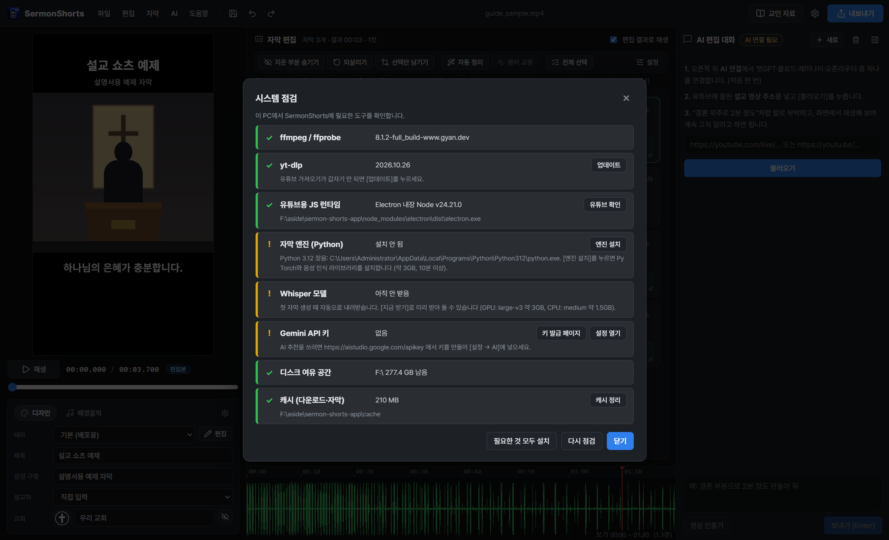

설치가 중단되었다면 점검 창의 오류 문구를 확인한 뒤 **엔진 설치**를 다시 누르세요. 강제로 재설치하는 방법은 뒤쪽 문제 해결 항목을 참고하세요.

<!-- page -->

## 3. 영상 열기와 자막 만들기

### 내 PC의 설교 파일

1. **파일 → 영상 파일 열기**(Ctrl+Shift+O)를 누르고 MP4 등 영상 파일을 고릅니다. 처음 화면의 **[영상 파일 열기]** 카드로도 열 수 있습니다.
2. 왼쪽에 영상이 나오면 **자막 → 자막 만들기**를 누릅니다.
3. 인식이 완료되면 오른쪽에 번호와 시간이 붙은 자막 블록이 나타납니다.
4. 영상이 길면 시간이 걸립니다. 엔진 준비 오류는 **도움말 → 시스템 점검**에서 먼저 확인하세요.

### 유튜브 설교 가져오기

1. **파일 → 유튜브에서 가져오기**(Ctrl+U)를 누릅니다.
2. 설교 영상 주소를 붙여넣습니다. 정보를 읽을 때까지 기다립니다.
3. 구간 선택 화면에서 시작·끝을 정하고 해당 구간을 가져옵니다.
4. 앱은 스트림으로 먼저 미리 보고 선택한 구간의 고화질 영상·음성을 받습니다. 유튜브의 제한이나 네트워크 상태에 따라 실패할 수 있습니다.

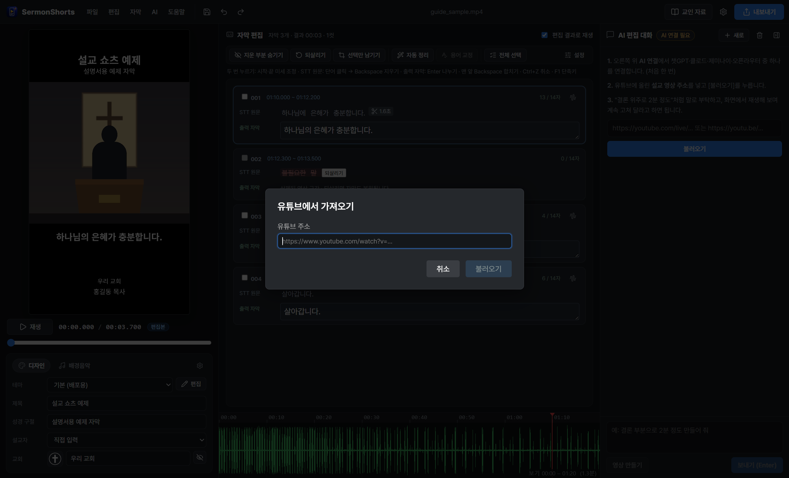

본인 소유 영상이나 사용 허가를 받은 설교만 사용하세요. 전체 생중계를 항상 먼저 내려받는 방식은 아닙니다. 인터넷 오류가 나면 같은 버튼을 반복 누르기보다 **도움말 → 시스템 점검 → yt-dlp 업데이트**와 주소를 확인하세요.

<!-- page -->

## 4. 가장 중요한 차이: 원문과 출력 자막

각 블록에는 서로 다른 두 줄이 있습니다.

- **STT 원문:** 처음 인식한 글자입니다. 인식 오류가 있어도 비교를 위해 남겨 둡니다. 이 줄에서 단어를 삭제하면 **영상 구간도 잘립니다**.
- **출력 자막:** 실제 영상과 SRT에 나갈 글자입니다. 이 칸을 고치면 **자막만 바뀌고 영상 시간은 유지됩니다**.

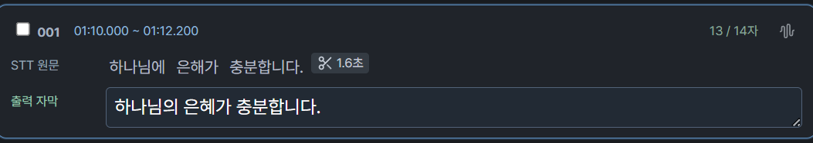

1. 오타는 아래 **출력 자막** 입력칸을 클릭해 고칩니다.
2. **Enter**를 누르거나 다른 곳을 클릭하면 적용됩니다. **Esc**는 지금 고치는 문장을 취소합니다. **Tab**은 다음 출력 칸으로 이동합니다.
3. 미리보기에도 수정한 문장이 반영됩니다. 입력칸을 빈칸으로 만들면 **그 구간의 자막만 숨깁니다. 영상은 남습니다**.

문장 전체를 고칠 수 있습니다. 수정한 자막은 인식 단어에 연결되어 저장되므로 원문은 바뀌지 않습니다. 예전 프로젝트에 원문 기록이 전혀 없으면 당시 저장된 글자를 최초 원문으로 삼습니다.

<!-- page -->

## 5. 14자 자막과 행 합치기

자막 편집 칸 위 도구 줄의 **설정**을 누르면 나오는 **자막 한 줄 최대**는 기본 14자입니다. 같은 곳에서 컷 앞뒤 여백과 페이드도 정합니다. 공백은 세지 않고 문장부호는 셉니다. 1~200자를 직접 입력하거나 8·12·14·16·20자 프리셋을 고를 수 있습니다.

**긴 단어도 나누기**를 켜면 한 단어가 제한을 넘어도 출력 자막을 나눕니다. 끄면 긴 단어 하나가 제한을 넘을 수 있습니다. 긴 단어 내부의 표시 시각은 글자 수 비례로 나누며, 실제 음절을 다시 인식하는 기능은 아닙니다.

### 위 문장에 붙이고 싶을 때

1. 아래 출력 자막의 **맨 앞**에 커서를 둡니다.
2. 선택한 글자가 없는 상태에서 **Backspace**를 누릅니다.
3. 위 출력 자막과 합쳐지고 커서는 두 문장이 만나는 위치에 놓입니다. 영상이나 STT 원문은 바뀌지 않습니다.

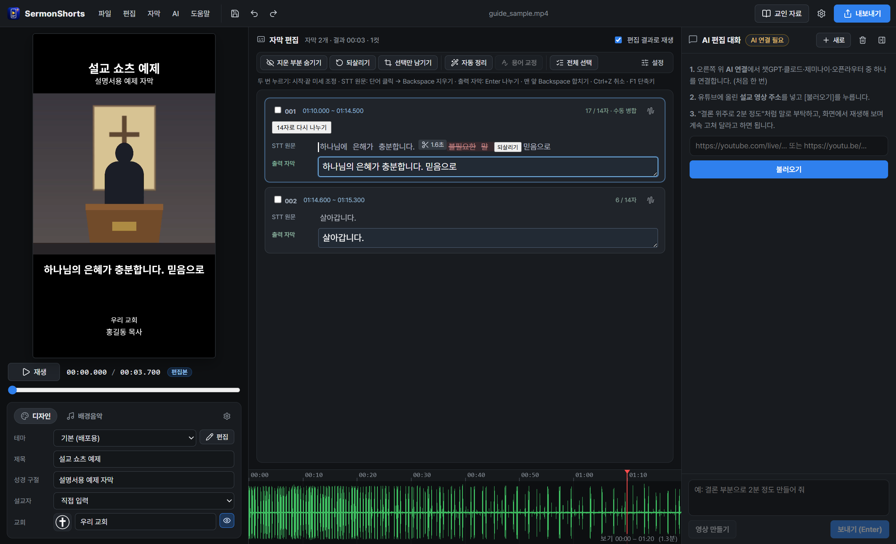

수동으로 합친 행은 14자를 넘어도 다시 갈라지지 않도록 **수동 병합**으로 표시합니다. 자동 분할로 돌아가려면 **14자로 다시 나누기**를 누르세요. **Ctrl+Z**로 병합을 취소할 수도 있습니다. 첫 행 맨 앞의 Backspace는 아무 구간도 지우지 않습니다.

<!-- page -->

## 6. 여러 구간을 한꺼번에 삭제하기

1. 지울 블록 번호 앞 **체크박스**를 체크합니다. 떨어져 있는 구간도 여러 개 고를 수 있습니다.
2. 위쪽의 **선택 구간 삭제 (N개)**를 누릅니다.
3. 체크한 구간의 영상이 잘리고, 체크하지 않은 구간은 남습니다.
4. 잘못 잘랐다면 **Ctrl+Z 한 번**으로 이번 일괄 삭제 전체를 복원합니다.

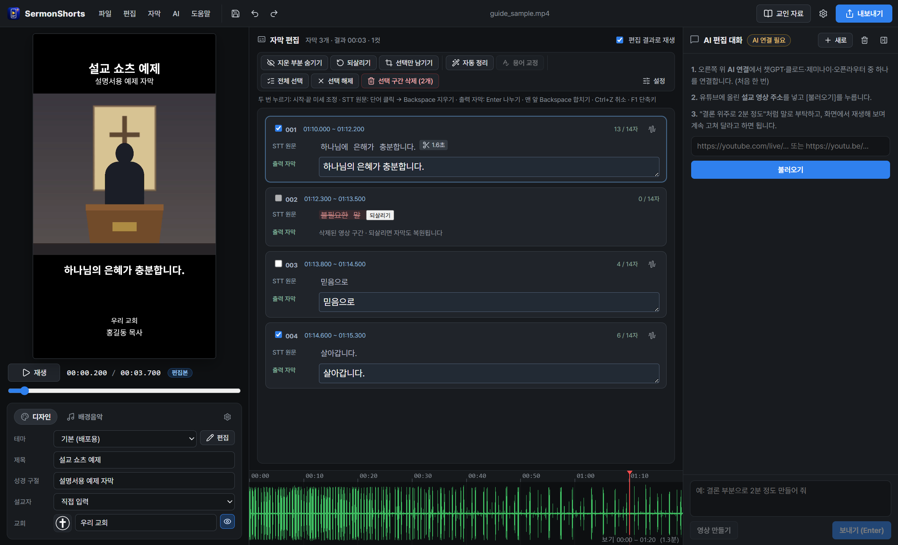

**전체 선택**은 모든 남은 구간을 고르고, **선택 해제**는 체크만 풉니다. 체크하는 것만으로는 삭제되지 않습니다.

영상 삭제의 기본 단위는 인식 단어입니다. 긴 단어를 여러 자막으로 나눠 표시한 경우 그 단어를 공유하는 블록은 함께 선택됩니다. 단어 안의 정확한 컷은 다음 장의 트림 패널을 사용하세요.

<!-- page -->

## 7. 단어 하나만 자르기와 되살리기

**STT 원문 줄**에서 지울 단어 뒤를 클릭해 커서를 두고 **Backspace**를 누르면 앞 단어와 해당 영상 구간을 지웁니다. **Delete**는 커서 뒤 단어를 지웁니다.

여러 단어를 마우스로 끌거나 Shift+방향키로 선택한 뒤 지울 수 있습니다. 이미 지운 단어는 흐린 취소선으로 표시됩니다.

- 지운 덩어리의 **되살리기** 버튼: 해당 덩어리 복원
- **R**: 커서 옆 또는 선택한 지운 부분 복원
- **노란 [군말]**: 음·어·아처럼 군말이라 지운 곳. 누르면 되살립니다.
- **노란 [공백 0.4초]**: 말 사이 공백을 잘라 낸 곳. 옆의 **되살리기**로 공백을 돌려놓습니다.
- **점선 [쉼 0.8초]**: 남겨 둔 긴 쉼. 누르면 그 자리만 잘라 냅니다.
- **Ctrl+Z**: 방금 작업 취소
- **Ctrl+Shift+Z**: 다시 실행
- **지운 부분 숨기기**: 남은 문장만 보기. 숨긴 표시를 누르면 다시 펼칩니다.

### 음성 인식 뒤 군말·공백 자동 정리

**자막 만들기**(음성 인식)가 끝나면 군말(음·어·아·에)과 0.3초 넘는 말 사이 공백을 실제 소리에서 찾아 바로 지웁니다. 지운 곳은 위 노란 표시로 남아 편집자가 한눈에 보고 되돌릴 수 있고, 자막 편집 머리줄에 `군말 3 · 공백 12곳 −4.2초`처럼 요약이 나옵니다. **Ctrl+Z** 한 번이면 정리 전체를 취소합니다. 끄려면 자막 편집 **설정 → 음성 인식 뒤 군말·말 사이 공백 자동으로 지우기**를 해제하세요. 나중에 다시 하려면 **자동 정리**(Ctrl+Shift+C)를 누릅니다.

출력 입력칸 안에서 타이핑하는 동안에는 영상 삭제 단축키가 글자를 지우는 일반 키로 동작합니다. 영상 구간을 자를 때는 먼저 STT 원문 쪽을 클릭하세요. 글자가 아니라 **영상 컷**을 만드는 단계라는 점을 기억하면 실수를 줄일 수 있습니다.

<!-- page -->

## 8. 컷 경계와 자막 시작·끝을 정밀하게 다듬기

**STT 원문**이나 **출력 자막**을 **두 번 누르면**(또는 자막 머리줄의 파형 단추) 그 자막의 **시작·끝 미세 조정** 패널이 열립니다.

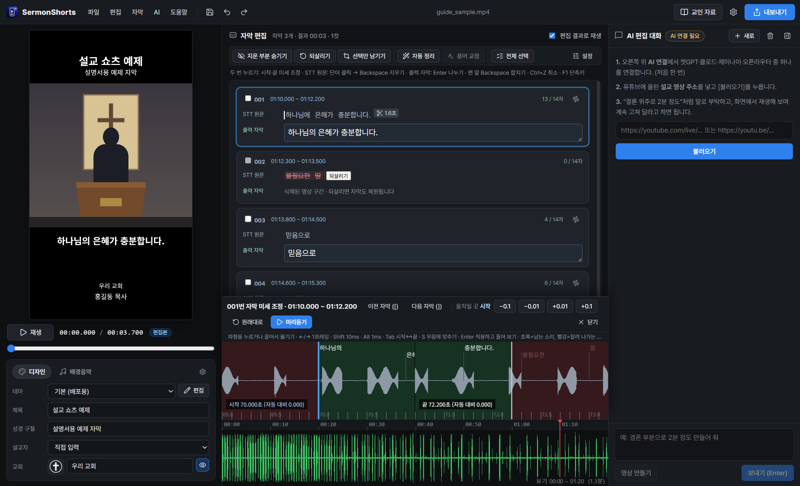
 왼쪽은 시작, 오른쪽은 끝이며, 초록은 남는 소리, 빨강은 잘려 나가는 소리입니다. 이어서 말한 가운데 자막도 시작을 뒤로·끝을 앞으로 당기면 그 자리에 컷이 생기고, **원래대로**(R)를 누르면 컷이 없어집니다. **Space / 미리듣기**는 편집 결과대로 자막 앞뒤를 들려주고 저절로 멈춥니다. **[ / ]** 로 이전·다음 자막, **Enter**로 적용하고 들어 봅니다.

단어를 지운 뒤 소리가 너무 급하게 끊기면 STT 원문의 가위 표시(잘라 낸 초)를 누르세요. 또는 원문 쪽에서 **T**로 가까운 컷을 엽니다.

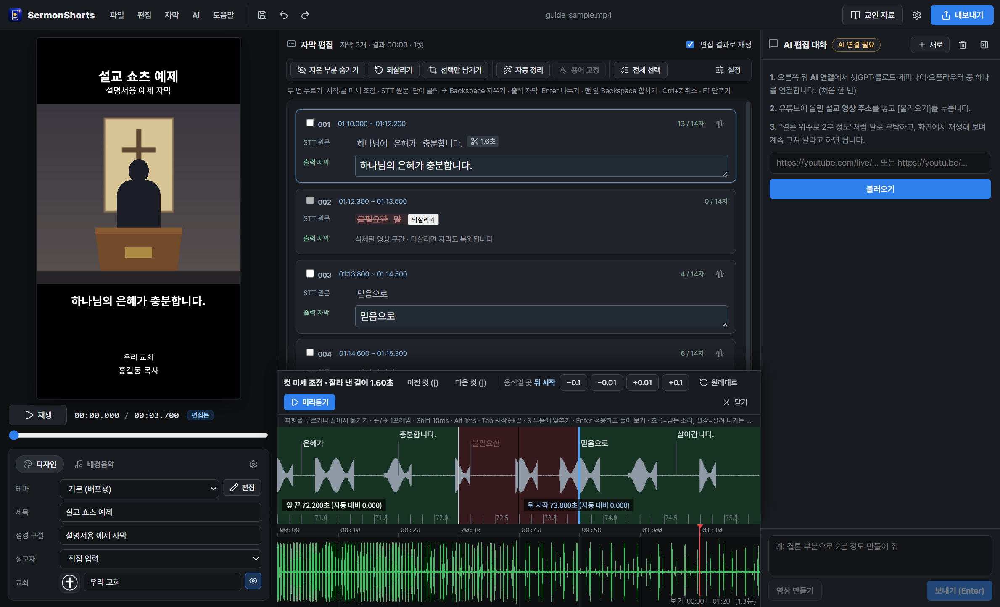

왼쪽 **A 끝**은 앞 장면을 어디까지 남길지, 오른쪽 **B 시작**은 다음 장면을 어디서 시작할지 정합니다.

- 손잡이를 마우스로 끌어 조정합니다.
- **Tab** 또는 **1/2**: A/B 손잡이 전환
- **←/→**: 한 프레임씩 이동
- **Shift+←/→**: 10ms, **Alt+←/→**: 1ms 이동
- **S**: 가까운 무음, **Alt+S**: 제로 크로싱에 붙이기
- **Space / 미리듣기**: 이음새 앞뒤를 반복해서 듣기
- **R**: 선택한 손잡이를 자동값으로 되돌리기
- **Esc**: 닫기

정밀 편집은 반드시 **소리로도** 확인하세요. 숫자가 맞아도 말의 첫소리가 잘리거나 숨소리가 어색할 수 있습니다.

<!-- page -->

## 9. 우리 교회 정보와 디자인 바꾸기

### 교회 이름·로고·설교자

왼쪽 **디자인** 카드에서 바로 고칩니다. **교회** 칸에 이름을 쓰면 미리보기에 곧바로 보이고 설정에도 저장됩니다. 왼쪽 로고 단추로 로고 이미지를 바꾸고, 오른쪽 눈 단추로 쇼츠에 교회 이름·로고를 보이거나 숨깁니다(기본 테마는 숨김, 이 프로젝트에만 적용). 설교자를 **직접 입력**했다면 옆의 **+** 로 목록에 저장합니다. 설교자 목록·기본 설교자·자주 쓰는 말은 카드 오른쪽 위 톱니(**설정 → 교회 정보**)에서 정합니다. 로고는 투명 배경 PNG를 권장합니다.

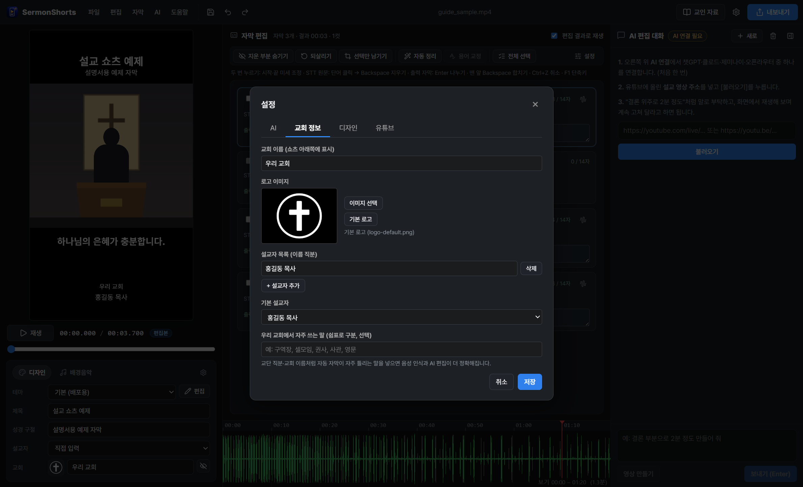

### AI 편집 대화 버튼

오른쪽 **AI 편집 대화** 아래의 버튼으로 자주 하는 지시를 한 번에 보낼 수 있습니다.

- **편집 조건**: 길이(1분·1분 30초·2분·2분 30초·3분), 다듬기(늘어지지 않게, 군말·반복 빼기, 질문·대답 빼기, 진행 안내 빼기, 공백 없애기, 결론으로 끝내기), 내용(핵심 메시지·예화·말씀 풀이·삶의 적용·위로·도전·복음·기도, 여러 개), 대상(모두·성도·처음 온 분·청년), 강도(상관없음, 1 잔잔 ~ 5 강하게), 후보 수(3·4·5곳)를 고릅니다. 고른 조건은 이 PC 에 기억되고, 만들 때마다 AI 에게 함께 전달됩니다. 공백 없애기를 켜면 줄어들 몫까지 생각해 조금 넉넉히 고르게 합니다.
- **구간 3곳 추천받기**: 바로 만들지 않고 후보 3곳(시각·길이·제목·추천 이유·자막)을 먼저 보여 줍니다. **[이 구간으로 만들기]** 를 누르면 그 범위 안에서만 만들고, **[유튜브에서 보기]** 로 그 시각부터 원본을 볼 수 있습니다.
- **만든 뒤 버튼**: 공백 없애기, 늘어지지 않게, 군말·반복 빼기, 질문·대답 빼기, 진행 안내 빼기, 더 짧게, 더 길게, 결론으로 끝내기, 제목 다시, 자막 오타 고치기, 다른 구간 3곳 추천. 길이 버튼을 누르면 그 길이로 다시 맞춥니다.
- **공백 없애기**는 AI 를 쓰지 않습니다. 영상의 실제 소리에서 조용한 부분(0.15초 이상)을 찾아 말과 말 사이만 줄이고, 말소리는 자르지 않습니다. Ctrl+Z 로 되돌릴 수 있습니다.
- 완성 길이가 목표와 15초 넘게 다르면 **[목표 길이로 맞추기]** 버튼이 나옵니다.

### 테마

왼쪽 아래 **디자인** 칸에서 테마를 고르고 **편집**을 누릅니다. 제목·성경 구절·영상·자막·하단 정보의 위치, 크기, 색, 글꼴 등을 바꿀 수 있습니다.

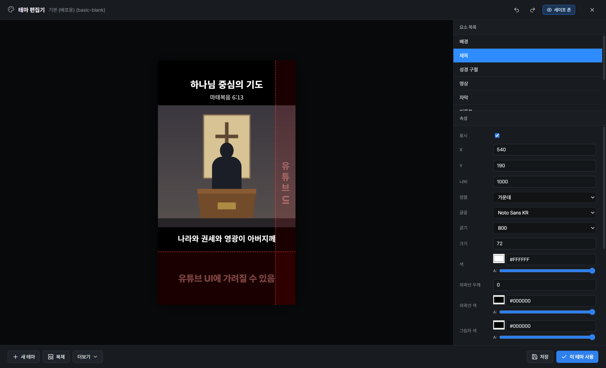

기존 테마를 보존하려면 **복제**해서 바꾸세요. **저장** 후 **이 테마 사용**으로 적용합니다. 세이프 존 표시는 유튜브 버튼 등에 가릴 수 있는 자리의 참고선입니다.

테마로 할 수 있는 것:

- **배경 방식**: 단색, 그라데이션, **흐린 영상**(설교 영상을 크게 키워 흐리게 깔기)
- **제목 줄바꿈과 강조**: 제목 칸에 `오늘의 말씀 / 하나님 중심의 기도`처럼 ` / `를 넣으면 화면에서 줄이 바뀝니다. `*기도*`처럼 별표로 감싼 말은 테마의 강조 색으로 보입니다. 자막 문구에도 같은 방법으로 강조할 수 있고, SRT와 유튜브 제목에는 별표·` / `가 빠집니다.
- **단어 강조 자막**: 말하는 단어만, 또는 읽은 단어까지 색이 바뀝니다. 단어 시각은 자막의 단어 시각을 따릅니다.
- **글자 꾸미기**: 여러 줄(최대 줄 수·줄 간격), 줄마다 다른 색, 글자 상자(줄마다/한 덩어리), 가로 띠, 기울임, 외곽선·그림자
- **이름표**: 설교자 이름 등을 색 상자에 담아 표시 (`{speaker}`, `{church}`, `{verse}`)
- **영상 카드**: 둥근 모서리, 그림자, 테두리, 가장자리 페이드
- **로고 머리띠**: 로고 오른쪽에 교회 이름·설교자를 붙여 표시

기본 테마에는 여러 교회 쇼츠에서 자주 보이는 배치를 참고한 테마가 들어 있습니다: 흐린 배경 + 손글씨 질문, 검은 바탕 두 줄 헤드라인, 둥근 영상 카드 + 이름표, 채널 머리띠 + 흐린 배경, 넓은 영상 + 단어 강조 자막, 꽉 찬 영상 + 알약 자막. 다른 교회의 로고·이름은 넣지 않았으니 우리 교회 정보로 채워 쓰세요.

배포본에는 재배포 허가가 확인된 공개 글꼴만 포함했습니다. 본인이 사용 권한을 가진 글꼴은 **글꼴 추가**로 넣을 수 있으며, 없으면 대체 글꼴을 사용합니다.

<!-- page -->

### 배경음악

디자인 카드의 **배경음악** 탭에서 **음악 고르기**를 누르면 설교 쇼츠에 많이 쓰는 분위기(잔잔한 피아노·묵상·희망·찬송가 연주·클래식)로 고른 음악 목록이 열립니다. 모두 **퍼블릭 도메인이거나 CC BY**처럼 저작권이 공개된 곡입니다. 음악은 프로그램에 들어 있지 않고 원래 사이트(incompetech.com, 위키미디어 공용)에서 **바로 재생**하므로 인터넷이 필요합니다. 줄마다 ▶ 단추로 듣고 다시 누르면 일시정지합니다. 마음에 들면 **이 음악 쓰기**.

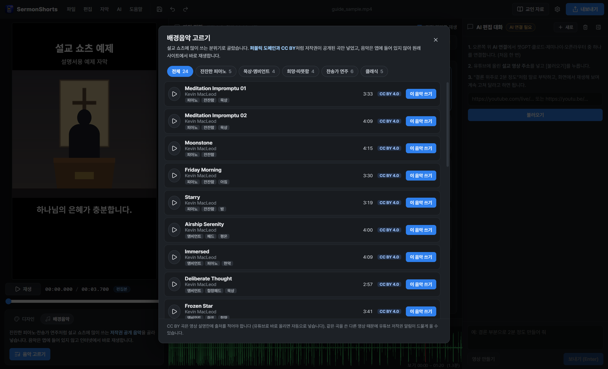

- **구간**: 파형의 파란 손잡이를 끌거나 시간을 적어 곡에서 쓸 부분을 고릅니다. **구간 듣기**로 그 부분만 들어 봅니다.
- **맞추기**: **처음에 시작**은 영상이 시작할 때 음악도 시작하고, **끝에 끝남**은 영상이 끝날 때 음악도 끝나도록 맞춥니다. 구간이 영상보다 길면 앞부분(처음에 시작) 또는 뒷부분(끝에 끝남)만 쓰고, 짧으면 끝에 맞출 때 그만큼 늦게 시작합니다. 파형의 진한 부분이 실제로 쓰이는 곳, 노란 선이 페이드 모양입니다.
- **페이드 인·아웃**과 **크기**(말소리에 비한 음악 크기, 기본 20%)를 정합니다.
- 왼쪽 **재생**(또는 Space)으로 **영상과 함께** 들어 보고, 내보낼 때 말소리 위에 섞입니다. 음악은 내보낼 때만 잠깐 받아 둡니다.
- **CC BY** 곡은 영상 설명란에 출처를 적어야 합니다. 앱에서 유튜브로 바로 올리면 출처가 설명에 자동으로 들어가고, 직접 올릴 때는 카드 아래 **복사**를 눌러 붙여 넣으세요. 같은 곡을 쓴 다른 영상 때문에 유튜브 저작권 알림이 드물게 올 수 있습니다.

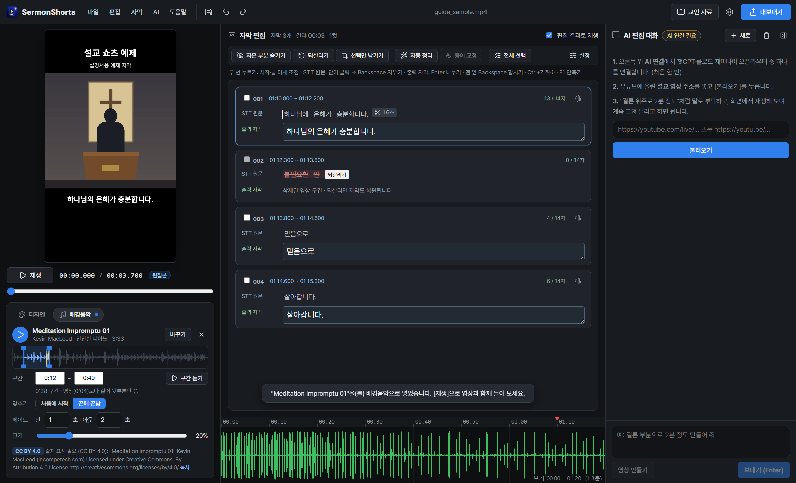

<!-- page -->

## 10. 저장하고 완성 영상 내보내기

### 작업 저장: 다음에 이어서 편집

**저장 / Ctrl+S**로 `.sshorts` 프로젝트 파일을 만듭니다. 다음부터 Ctrl+S는 같은 파일에 저장합니다. **Ctrl+Shift+S**는 다른 이름으로 저장합니다. 다음 작업 때 **프로젝트 열기 / Ctrl+O**로 불러옵니다.

프로젝트에는 자막·편집·트림·테마·커서 등을 저장하지만 **원본 영상 자체는 포함하지 않습니다**. 원본 영상도 함께 보관하세요. 원본 경로가 바뀌면 다시 열지 못할 수 있습니다.

### 결과 저장: 유튜브에 올릴 파일

1. **내보내기 / Ctrl+E**를 누릅니다.
2. MP4 파일 이름과 저장 위치를 고릅니다.
3. 완료될 때까지 기다립니다. 같은 이름의 **MP4와 SRT**가 만들어집니다.
4. 결과 영상을 직접 재생해 자막, 잘린 구간, 소리 이음새를 확인합니다.

MP4는 **1080×1920, H.264 영상 + AAC 음성**입니다. SRT에는 STT 오류 원문이 아니라 **수정한 출력 자막**이 들어갑니다. 지원 환경에서는 GPU 인코딩을 시도하고 실패하면 CPU 인코딩으로 전환합니다.

유튜브에서 받은 원본은 캐시에 있을 수 있습니다. 프로젝트를 보관하려면 원본을 안전한 폴더에 따로 보관한 뒤 **캐시 정리**를 사용하세요. 프로젝트 파일만으로 지운 원본을 되살릴 수 없습니다.

<!-- page -->

## 11. 교인 자료 만들기 (소그룹·QT·퀴즈·요약·묵상카드·가정예배지)

오른쪽 위 **교인 자료**(또는 **AI → 교인 자료 만들기**)를 누르면 설교 한 편으로 성도들에게 나눠 줄 자료를 만드는 밝은 작업 화면이 열립니다.

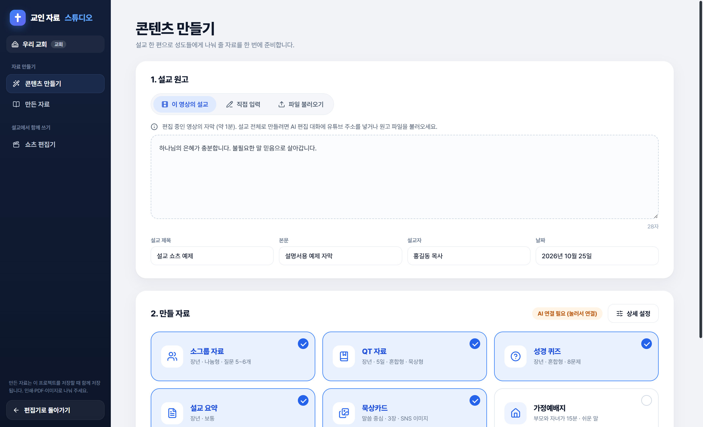

1. **설교 원고**: **이 영상의 설교**는 AI 편집 대화에 넣은 유튜브 설교 자막 전체(AI 가 찾은 설교 부분)를 가져오고, 없으면 편집 중인 영상의 자막을 씁니다. **직접 입력**하거나 **파일 불러오기**(.txt·Word .docx·자막 .srt)도 됩니다. 아래 칸에서 바로 고칠 수 있고, 설교 제목·본문·설교자·날짜를 확인합니다.
2. **만들 자료**: 소그룹 자료, QT 자료, 성경 퀴즈, 설교 요약, 묵상카드, 가정예배지 가운데 고릅니다. **상세 설정**에서 대상(장년·청년·청소년·어린이·유아)과 소그룹 형식(나눔형·공부형), QT 일수·본문·형식, 퀴즈(OX·객관식), 요약 분량, 묵상카드 분위기·장수를 정합니다.
3. **선택한 자료 만들기**: 연결한 AI(챗GPT·클로드·제미나이·오픈라우터)가 설교에 있는 내용만으로 만듭니다. 자료마다 30초~1분쯤 걸립니다.

**만든 자료**에서 글자를 누르면 그 자리에서 고칩니다. 인쇄 자료는 **PDF로 저장**·**인쇄**, 묵상카드는 디자인(새벽 남색·종이·하늘·영상 장면)을 골라 **이미지로 저장**(1080×1350 PNG), 어떤 자료든 **글 복사**로 카톡·문자에 붙여 넣을 수 있습니다. 만든 자료는 프로젝트를 저장할 때 함께 저장됩니다.

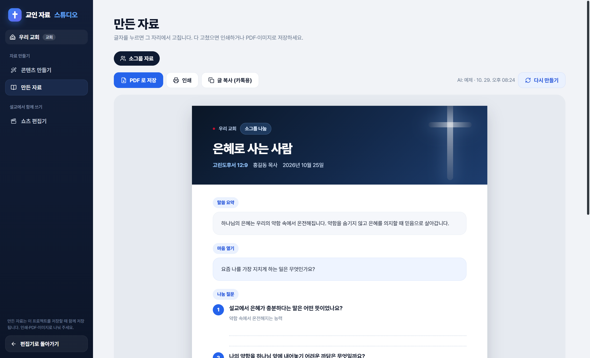

AI 가 만든 글은 꼭 한 번 읽어 보고 다듬어 주세요. 성경 본문은 장절만 적도록 했으니 필요하면 교회에서 쓰는 성경 본문을 붙여 넣으세요.

<!-- page -->

## 12. 선택 기능: AI 쇼츠 추천

기본 자막 편집과 로컬 음성 인식에는 Gemini API 키가 필요하지 않습니다. **AI 추천·AI 교정·AI 연결 확인은 외부 API를 사용하며 비용이 발생할 수 있습니다**. 결제와 한도는 본인의 Google 계정에서 확인하세요.

1. **설정 → AI**에서 본인의 Gemini API 키와 모델을 설정하고 저장합니다. 키는 이 Windows 계정에 암호화 저장합니다. 프로젝트나 배포 파일에 넣지 않습니다.
2. **AI → AI 쇼츠 추천**을 누릅니다.
3. 길이·개수·강도·대상·내용 유형과 추가 요청을 고릅니다.
4. 유튜브 주소를 넣고 **분석**을 누릅니다. 결과 후보를 읽어 원하는 구간을 가져옵니다.

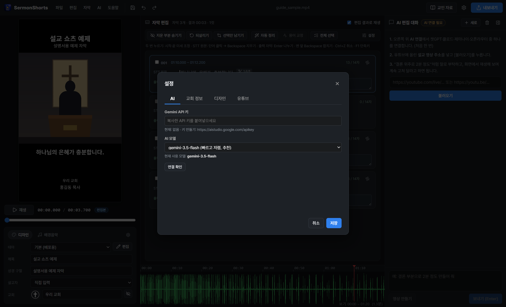

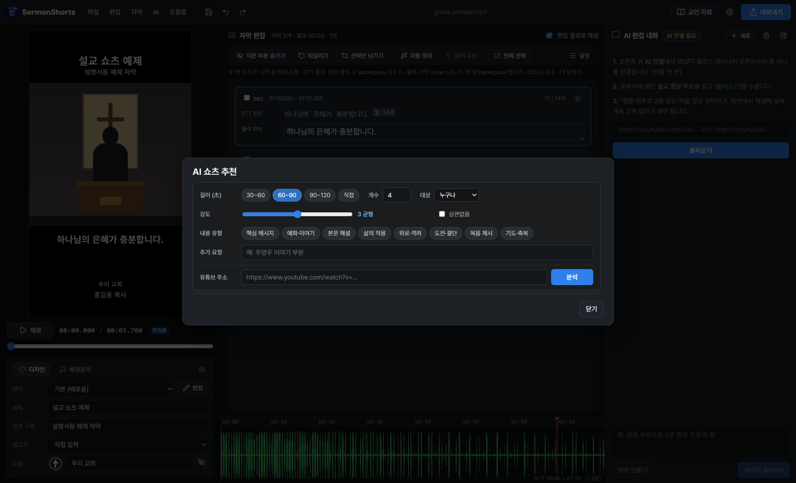

비용을 아끼려면 후보 개수를 작게 시작하고, 분석 버튼이나 연결 확인을 반복해서 누르지 마세요. 앱 개발 검증과 이 설명서 캡처는 새 AI 요청 없이 진행했습니다. AI가 고른 구간도 문맥과 신학적 의미가 왜곡되지 않는지 직접 확인하세요.

<!-- page -->

## 13. 막힐 때와 자주 쓰는 키

**아무것도 먼저 다시 설치하기보다 도움말 → 시스템 점검을 확인하세요.**

- **자막 엔진 없음:** **시스템 점검 → 엔진 설치** (Python 3.12가 없으면 함께 설치)
- **엔진 재설치:** **시스템 점검 → 엔진 다시 설치**, 또는 PowerShell에서 `& '.\Setup-Subtitle-Engine.cmd' -Force` 실행. GPU가 있어도 CPU로 설치하려면 `-Cpu` 사용
- **유튜브 가져오기 실패:** 주소·인터넷·접근 권한을 확인하고 시스템 점검에서 yt-dlp 업데이트
- **내보낼 구간 없음:** 모든 구간이 지워졌는지 확인하고 되살리기
- **프로젝트가 열리지 않음:** 원본 영상 파일이 같은 경로에 있는지 확인
- **글꼴이 달라짐:** 배포본 제외 글꼴 또는 다른 PC의 사용자 글꼴인지 확인하고, 사용 권한이 있는 글꼴을 추가
- **영상이 느리거나 출력이 오래 걸림:** CPU 처리일 수 있습니다. 짧은 구간으로 먼저 시험하세요.

**꼭 기억할 키:** Space 재생/정지, Ctrl+S 저장, Ctrl+O 프로젝트 열기, Ctrl+E 내보내기, Ctrl+Z 실행 취소, Ctrl+Shift+Z 다시 실행, F1 단축키 도움말.

**데이터 위치:** 설정은 `%APPDATA%\SermonShorts`, 설치판 캐시·엔진은 그 안의 `runtime`에 있습니다. ZIP판도 이 Windows 사용자 폴더에 데이터를 저장합니다. 사용자 설정·키·모델은 앱 폴더를 복사하는 것만으로 다른 PC에 옮겨지지 않습니다.

**베타 범위:** 긴 시간 연속 편집, 모든 GPU/드라이버, 유튜브 정책 변경을 보장하지 않습니다. 자막을 먼저 저장하고 짧은 구간부터 시험하세요. 배포 파일에는 개인 API 키·테스트 원본 영상·기존 엔진·모델이 포함되지 않습니다.

앱의 **도움말 → 사용 설명서**로 이 PDF를 다시 열 수 있습니다. 세부 단축키와 설치 방법은 GitHub `docs/SHORTCUTS.md`, `docs/INSTALL.md`도 참고하세요.
